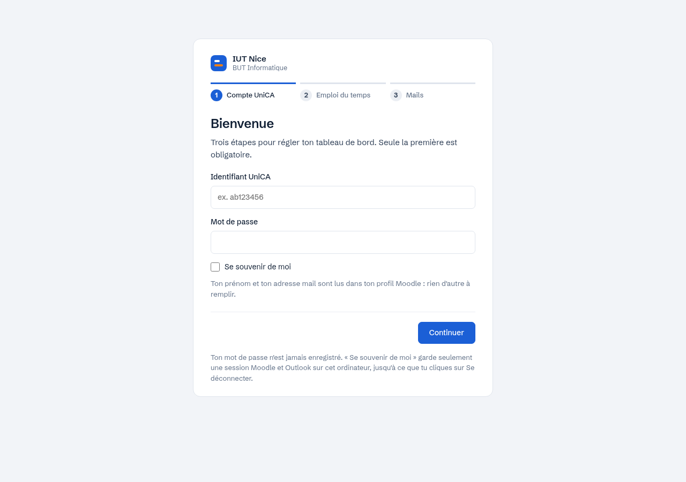
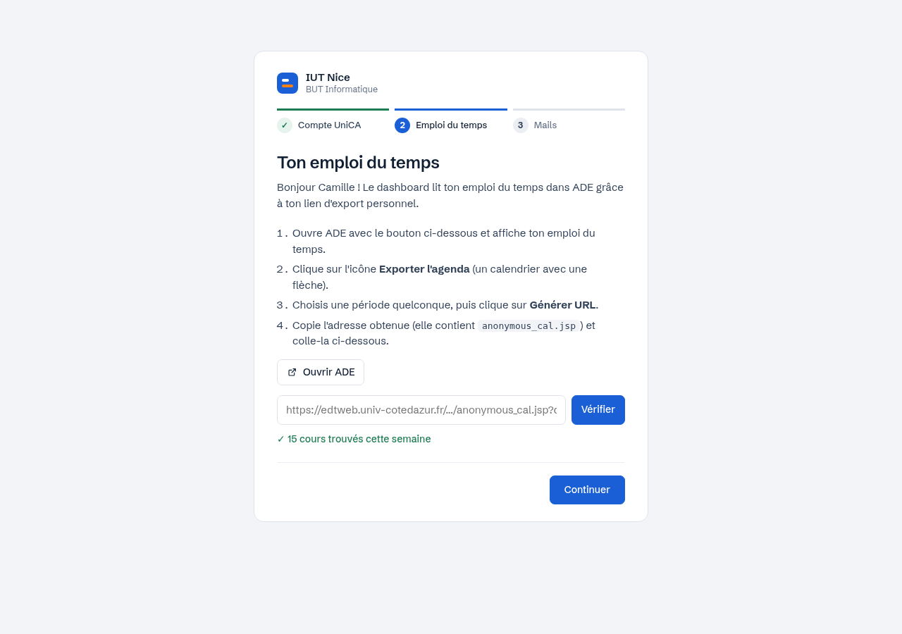
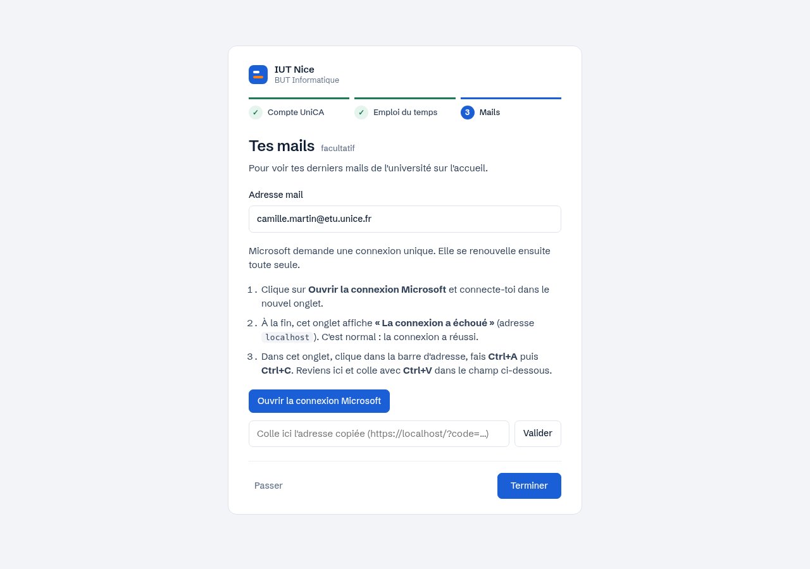
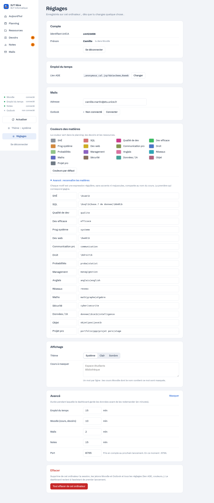

# Dashboard IUT

Ton tableau de bord de l'IUT Nice Côte d'Azur, sur une seule page : emploi du temps ADE, cours et documents Moodle, devoirs à rendre, notes et derniers mails.

Tout tourne **sur ton ordinateur**. Rien n'est envoyé ailleurs que vers Moodle, ADE, la passerelle de notes de l'IUT et Microsoft (pour les mails).

---

## Installer en 4 étapes (aucune connaissance en code nécessaire)

### 1. Télécharger le dashboard

Sur la page GitHub du projet, clique sur le bouton vert **Code**, puis **Download ZIP**. Ouvre le fichier téléchargé et **extrais-le** (clic droit → « Extraire tout » sous Windows ; double-clic sur macOS) dans un dossier facile à retrouver, par exemple tes Documents.

### 2. Installer Python (si tu ne l'as pas déjà)

Le dashboard a besoin de **Python 3.8 ou plus récent**, un programme gratuit.

- **Windows / macOS** : télécharge-le sur [python.org/downloads](https://www.python.org/downloads/) et installe-le. Sous Windows, **coche la case « Add python.exe to PATH »** en bas de la première fenêtre de l'installation.
- **Linux** : Python est en général déjà là (sinon : `sudo apt install python3`).

Pas sûr ? Passe directement à l'étape 3 : si Python manque, le lanceur te le dit et te donne le lien.

### 3. Double-cliquer sur le lanceur

| Système | Fichier à double-cliquer |
|---|---|
| Windows | `lancer.bat` |
| macOS | `lancer.command` (la première fois : clic droit → **Ouvrir**, puis **Ouvrir** à nouveau, car macOS bloque les fichiers téléchargés) |
| Linux | `lancer.sh` (ou dans un terminal : `./lancer.sh`) |

Une fenêtre noire s'ouvre : **laisse-la ouverte** tant que tu utilises le dashboard (la fermer arrête le dashboard). Ton navigateur s'ouvre tout seul sur `http://localhost:8765`.

### 4. Suivre l'assistant

Au premier lancement, un assistant en trois étapes s'affiche. Seule la première est obligatoire.

**Étape 1 : ton compte UniCA.** Ton identifiant et ton mot de passe de l'université. Ton prénom et ton adresse mail sont lus dans ton profil Moodle : rien d'autre à remplir.



**Étape 2 : ton emploi du temps.** Clique sur **Ouvrir ADE**, puis :

1. Affiche ton emploi du temps dans ADE.
2. Clique sur l'icône **Exporter l'agenda** (un calendrier avec une flèche).
3. Choisis une période quelconque, puis **Générer URL**.
4. Copie l'adresse obtenue (elle contient `anonymous_cal.jsp`) et colle-la dans l'assistant.

Le dashboard vérifie le lien tout de suite et affiche le nombre de cours trouvés cette semaine. Le lien `direct/index.jsp` de la barre d'adresse d'ADE ne marche pas : il sert à consulter, pas à exporter. Tu peux aussi passer cette étape et ajouter le lien plus tard dans **Réglages**.



**Étape 3 : tes mails (facultatif).** Vérifie ton adresse, puis connecte Outlook (voir [Mails Outlook](#mails-outlook) plus bas). Tu peux passer : la page **Mails** te le reproposera.



C'est fini : l'accueil s'ouvre. Les fois suivantes, double-clique simplement sur le lanceur.

> Pour essayer sans compte : `python3 dashboard.py --demo` (Windows : `py dashboard.py --demo`) affiche le dashboard avec des données fictives, et `--demo --setup` montre l'assistant.

---

## Réglages

Tout se change dans la page **Réglages** (en bas de la barre latérale, ou dans la barre du bas sur téléphone). Chaque changement est enregistré tout de suite.

- **Compte** : identifiant, prénom, **Se déconnecter**.
- **Emploi du temps** : ton lien ADE, affiché masqué (`…anonymous_cal.jsp?data=3eee…0aeeb`) car il contient un jeton personnel. **Changer** le vérifie de la même façon que l'assistant.
- **Mails** : adresse, état de la connexion Outlook, **Connecter** ou **Déconnecter**.
- **Couleurs des matières** : une couleur par matière, et **Couleurs par défaut**. La section repliée **Avancé** permet de modifier les motifs qui reconnaissent chaque matière.
- **Affichage** : thème (système, clair, sombre) et cours Moodle à masquer (un mot par ligne).
- **Avancé** : durées de cache et port (pris en compte au prochain lancement).
- **Tout effacer de cet ordinateur** : supprime la session, les jetons et tous les réglages ; l'assistant revient.



### Connexion et « Se souvenir de moi »

- **Sans « Se souvenir de moi »** : la session reste en mémoire et s'efface à l'arrêt. Au prochain lancement, il faudra te reconnecter.
- **Avec « Se souvenir de moi »** : une session Moodle et Outlook est gardée dans `.cache/` pour ne pas te reconnecter. **Ton mot de passe n'est jamais enregistré**, seulement des jetons d'accès.
- **Se déconnecter** efface la session et les jetons, mais **garde tes réglages** (lien ADE, couleurs…) : tu les retrouves à la connexion suivante.

À la connexion, le dashboard passe par le CAS de l'université, récupère un **jeton Moodle** (le même que l'app mobile Moodle), puis n'utilise plus que ce jeton.

### Mails Outlook

Ta messagerie `@etu.unice.fr` est sur Microsoft 365, qui **refuse le mot de passe** pour lire les mails depuis un programme. La connexion se fait donc une seule fois :

1. Étape 3 de l'assistant, page **Mails** ou **Réglages → Mails** → **Ouvrir la connexion Microsoft**, connecte-toi dans le nouvel onglet.
2. À la fin, l'onglet affiche « La connexion a échoué » (adresse `https://localhost/?code=…`). C'est normal : la connexion a réussi.
3. Dans cet onglet : barre d'adresse, **Ctrl+A**, **Ctrl+C**. Reviens sur le dashboard et colle (**Ctrl+V**) : la validation est automatique.

Le jeton se renouvelle ensuite tout seul (environ 90 jours sans utilisation avant expiration). Microsoft n'autorise pas de retour automatique vers le dashboard pour cette application, d'où le collage.

### Notes (Passerelle ScoDoc)

Les notes viennent de la passerelle de l'IUT (`https://iut-notes.unice.fr`). Aucun réglage n'est nécessaire.

- À la connexion, le dashboard ouvre aussi la session des notes avec le même compte UniCA (même cookie CAS que Moodle, le mot de passe n'est envoyé qu'une fois).
- **Rien n'est écrit sur le disque** : ni notes, ni mot de passe. Le mot de passe reste en mémoire tant que le serveur tourne (pour rouvrir la session quand elle expire) et s'efface à la déconnexion.
- Après une relance avec « Se souvenir de moi », il n'y a plus de mot de passe : la carte Notes demande « Mot de passe pour afficher tes notes ».
- Le dashboard respecte les options de ton département : si la promo ou les rangs sont masqués dans le relevé officiel, ils le sont aussi ici.
- Un échec de connexion aux notes ne bloque pas Moodle : il s'affiche comme erreur de la source « Notes » dans la barre latérale.

### Dépôt de devoirs

Depuis la page **Devoirs**, **Déposer** envoie tes fichiers à Moodle sans quitter le dashboard.

- Les règles du devoir (nombre de fichiers, taille, types, date limite, remise définitive ou non, déclaration) sont lues dans Moodle et contrôlées avant l'envoi, côté page et côté serveur.
- Un devoir « avec brouillon » : **Enregistrer le brouillon** autant de fois que tu veux, puis **Rendre définitivement**. Cette dernière étape passe toujours par un écran rouge de vérification (aperçu des fichiers, contenu des ZIP, deux cases à cocher, bouton actif après 3 secondes). Rien n'est rendu sans ça.
- Après chaque opération, le dashboard relit l'état dans Moodle et t'alerte si les fichiers ne correspondent pas à ce que tu as envoyé.
- Les fichiers restent **en mémoire** le temps de l'envoi : rien n'est écrit sur le disque. Un envoi est limité à 100 Mo (`UPLOAD_MAX`, voir « Pour aller plus loin »).
- Si le Moodle de l'IUT refuse le dépôt depuis un programme externe, le dashboard le dit et ne propose plus que le lien vers la page Moodle.
- Le mode `--demo` simule tout en mémoire.

## Ce que fait chaque page

- **Aujourd'hui** : cours en cours ou à venir, frise de la journée, devoirs les plus urgents, derniers mails.
- **Planning** : vue jour ou semaine, navigation semaine précédente / suivante.
- **Ressources** : tous les documents de tes cours, filtrables (Cours, TD, TP, Examens), groupés par section Moodle ou par type, avec recherche. Le bouton de téléchargement passe par le serveur local, donc pas besoin d'être connecté à Moodle dans le navigateur.
- **Devoirs** : en retard, cette semaine, plus tard, déjà rendus. **Déposer** ouvre un panneau de dépôt (voir plus bas) ; le lien vers la page Moodle reste toujours disponible.
- **Notes** : moyenne, rang et UE du semestre (par UE ou par matière, avec toutes les évaluations). Les nouvelles notes sont signalées.
- **Mails** : 25 derniers mails de la boîte de réception.
- **Réglages** : lien ADE, mails, couleurs, thème, cours masqués (voir plus haut).

## Sécurité

- Le serveur n'écoute que sur `127.0.0.1` et refuse les requêtes qui ne viennent pas de `localhost`.
- Tes réglages sont dans `.cache/settings.json` (lien ADE, adresse mail, couleurs, cours masqués, thème, options avancées), lisible par toi seul. **Jamais ton mot de passe.** Les jetons Moodle et Outlook sont aussi dans `.cache/`.
- Le lien ADE contient un jeton personnel : la page ne l'affiche jamais en entier. Ne partage pas le dossier `.cache/` ni des captures où il apparaîtrait.
- `.cache/` et `config.py` sont dans `.gitignore`. Si tu modifies le code, vérifie avec `git status` avant chaque push.
- Pour tout réinitialiser : **Réglages → Tout effacer de cet ordinateur** (ou supprime le dossier `.cache/`).

## Dépannage

| Problème | Solution |
|---|---|
| Rien ne se passe au double-clic (Windows) | Installe Python depuis python.org en cochant « Add python.exe to PATH », puis relance `lancer.bat`. |
| « lancer.command ne peut pas être ouvert » (macOS) | Clic droit sur le fichier → **Ouvrir** → **Ouvrir**. |
| « Connexion UniCA refusée » | Vérifie identifiant et mot de passe. Avec la double authentification, utilise `MOODLE_TOKEN` (voir plus bas). |
| « Ce lien sert à consulter ADE, pas à l'exporter » | Tu as collé l'adresse de la page ADE. Utilise **Exporter l'agenda** → **Générer URL**. |
| « Ce lien ne renvoie pas d'emploi du temps » | Régénère le lien d'export dans ADE et colle-le dans **Réglages → Emploi du temps → Changer**. |
| « Microsoft a refusé » / `AADSTS…` | L'université bloque peut-être l'application. Signale-le avec le code d'erreur. |
| Le tri CM/TD/TP se trompe | Il se base sur les noms (« TD3 », « TP », « Annales »…). Les règles sont dans `sources/moodle.py` (`CAT_RULES`). |
| « Le port 8765 est déjà utilisé » | Le dashboard tourne sans doute déjà : ouvre `http://localhost:8765`. Sinon, change le port dans **Réglages → Avancé** (ou lance avec `--port 8800`). |

---

## Pour aller plus loin

### Options de lancement

`python3 dashboard.py [options]` (Windows : `py dashboard.py`) :

| Option | Effet |
|---|---|
| `--demo` | Données fictives, sans compte. Rien n'est écrit sur le disque. |
| `--demo --setup` | L'assistant de premier lancement, en démo (le lien ADE fictif est accepté). |
| `--no-browser` | N'ouvre pas le navigateur. |
| `--port 8800` | Port pour ce lancement seulement. |
| `--verbose` | Affiche chaque requête dans la console. |

### `config.py` (facultatif)

Tu n'en as **pas besoin** : tout se règle dans la page. `config.py` sert aux options avancées qui n'ont pas de place dans Réglages (`MOODLE_URL`, `MOODLE_TOKEN`, `MAIL_NOMBRE`, `NOTES_URL`, `UPLOAD_MAX`, `OUVRIR_NAVIGATEUR`, `COULEURS_SECOURS`…).

`config-exemple.py` documente toutes ces options ; le dashboard ne le lit pas. Pour en changer une, crée un fichier `config.py` à côté de `dashboard.py` et recopie-y seulement les lignes voulues.

Pour chaque option, le dashboard prend dans l'ordre :

1. le réglage fait dans la page (`.cache/settings.json`) ;
2. sinon `config.py`, s'il existe ;
3. sinon la valeur par défaut (`sources/defaults.py`).

**Ancienne installation** : un `config.py` d'une version précédente marche tel quel, sans rien changer. Ses valeurs apparaissent dans Réglages (avec la mention « vient de config.py ») ; `PRENOM`, `MAIL_ADRESSE` et `ADE_ICAL_URL` y servent seulement de valeur de départ, et un changement fait dans la page passe devant. Avec un `config.py`, l'assistant ne s'affiche pas : l'écran de connexion habituel apparaît.

#### Jeton Moodle manuel (si la connexion automatique échoue)

Ça peut arriver si l'université ajoute une double authentification ou change sa page de connexion.

1. Installe l'app **Moodle** sur ton téléphone et connecte-toi une fois à `https://lms.univ-cotedazur.fr/2026`.
2. Sur le Moodle web : ton avatar → **Préférences** → **Clés de sécurité**.
3. Copie la clé de la ligne **Moodle mobile web service** dans `MOODLE_TOKEN = "..."` de ton `config.py`.

#### Couleurs : motifs et couleurs de secours

Dans `MATIERES`, chaque `motif` est une expression régulière **sans accents ni majuscules** ; la première qui correspond gagne, donc l'ordre compte. Une matière sans motif correspondant prend une couleur de `COULEURS_SECOURS`, choisie d'après son code (R3.01, etc.). Un motif ou une couleur invalide de `config.py` est ignoré avec un message dans la console ; dans la page, il est refusé avant d'être enregistré.

### Tests

```bash
python3 -m unittest discover tests
```

`tests/fixtures/notes_reel_anonyme.json` est une vraie réponse anonymisée de la passerelle de notes : elle est ignorée par git, ne la partage pas (les tests qui en ont besoin sont sautés sans elle).
